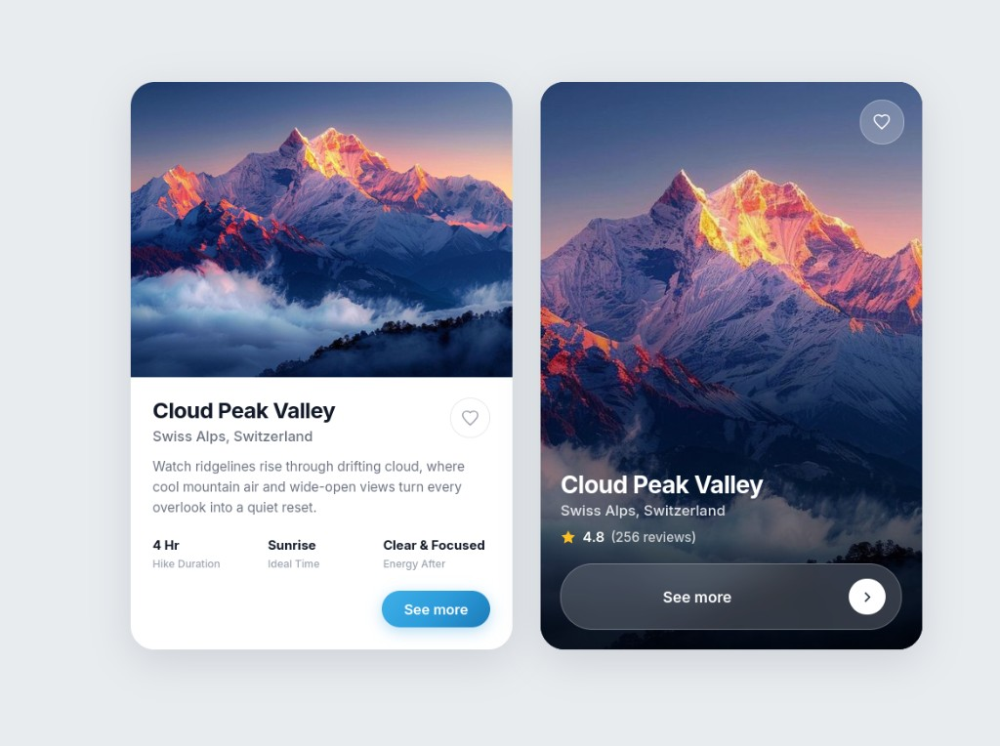

# destination-cards-ui

Side-by-side **travel destination card** UI with two variants: a classic split layout and a full-bleed overlay card with a glass-style CTA. Built with HTML, CSS, and vanilla JavaScript—no build step or framework.



## Features

- **Segmented card** — image header, title, description, three stats, gradient CTA, favorite toggle
- **Immersive card** — full-bleed photo, bottom gradient, rating, glassmorphism “See more” button
- **Layout** — cards stay in a single row on desktop (horizontal scroll on very small viewports)
- **Interactivity** — heart / favorite buttons (`js/script.js`)

## Demo content

**Cloud Peak Valley** · Swiss Alps, Switzerland (sample copy aligned with the hero image)

## Tech stack

- HTML5
- CSS3 (flexbox, gradients, `backdrop-filter`)
- JavaScript (ES6+)

## Getting started

1. Clone the repository.
2. Open `index.html` in a browser, or serve locally:

   ```bash
   python -m http.server 8080
   ```

3. Visit `http://localhost:8080`

Hero images load from an external URL (Pinterest CDN). You need internet unless you point the `` sources to a file under `assets/images/`.

## Project structure

```text
.
├── README.md
├── index.html
├── css/
│   └── styles.css
├── js/
│   └── script.js
└── assets/
    ├── images/
    │   └── preview.jpg
    └── reference/
        └── design-mockup.png
```

## License

MIT# destination-cards-ui
